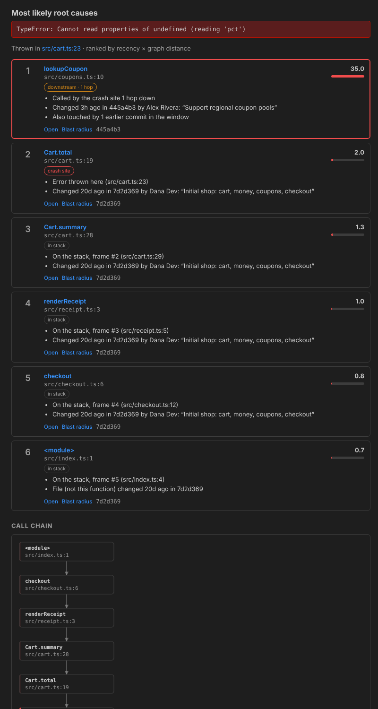

# Blast Radius — Error Trace & Impact Graph for VS Code

**Click a stack trace → get the ranked list of functions that most likely caused it, including the ones that aren't on the stack.**
**Before a refactor → see every caller, importer and test that will feel it.**
**Your AI assistant gets the same graph over MCP, answering in milliseconds instead of reading 30 files.**

Built on [Relate by Neo4j](https://relatedb.ai), the embedded graph database. The whole graph lives in one file, `.vscode/codegraph.rl`, with no server and no Docker.



---

## The problem

A test fails. The stack trace points at `Cart.total`, which hasn't changed in three weeks. The real cause is `lookupCoupon`, a helper that `Cart.total` calls. Someone changed it three hours ago so it can return `undefined`. It **isn't in the stack trace at all**, because the function already returned before the crash.

Finding it means grepping, `git log -p`, and reading code. Blast Radius finds it straight from the trace:

| # | Suspect | Why |
|---|---|---|
| **1** | `lookupCoupon` · `src/coupons.ts:10` | Called by the crash site 1 hop down · **changed 3h ago** in f84b1d8 by Alex Rivera: "Support regional coupon pools" |
| 2 | `Cart.total` · `src/cart.ts:19` | Error thrown here · last changed 20d ago |
| 3 | `Cart.summary` | On the stack, frame #2 |

The uncommitted edit in `inventory.ts` is *more recent*, but it is **not ranked**: it isn't connected to the crash in the call graph. Recency alone is noise; recency × graph distance is signal.

## How it differs from existing tools

Parts of this exist already, and it's worth being precise about which part is new.

| Tool | What it answers | Why it misses `lookupCoupon` |
|---|---|---|
| **Sentry Suspect Commits** | "Who last changed the code *in the stack trace*?" | It only looks at stack frames, so it blames the 3-week-old commit that wrote `Cart.total`. It also works on production errors in a hosted service, after the code has shipped. |
| **Code-graph MCP servers** (codegraph, code-graph-mcp, Arbor, …) | "What is connected to this function?" (call graphs, impact analysis for agents) | They have the call graph but don't read stack traces or rank by change history. You'd have to ask "what does `Cart.total` call?" and then run `git log` on each result yourself. |
| **Blast Radius** | "What changed recently *in the code connected to this error*?" | Combines the two: stack frames + call-graph neighbours, weighted by function-level git history. Runs locally, in your editor, while you develop. |

Blast radius ("what breaks if I change this?") and MCP tools for agents are useful supporting features, but they are not new on their own. The new part is ranking suspects **off the stack** from a trace.

## How it works

```
 on open / on save                         Relate (.vscode/codegraph.rl)
 ┌──────────────────────┐   UNWIND/MERGE   ┌───────────────────────────────────────────┐
 │ TS compiler API      │ ───────────────▶ │ (:File)-[:IMPORTS]->(:File)               │
 │ Python ast (stdlib)  │                  │ (:File)-[:DEFINES]->(:Function)           │
 │ git log -U0 -p       │                  │ (:Function)-[:CALLS]->(:Function)         │
 │ git diff HEAD -U0    │                  │ (:Commit)-[:MODIFIED]->(:File)            │
 └──────────────────────┘                  │ (:Commit)-[:TOUCHED]->(:Function) ◀ hunks │
                                           └───────────────────────────────────────────┘
        ▲                                        ▲                 ▲
 terminal shell-integration           Webview panel + CodeLens   MCP server (stdio)
 captures failing commands            (Cypher, in-process)       → localhost bridge → live graph
```

* **Function-level git history.** Every commit's diff hunks (`-U0`) are intersected with function line ranges. The result is a `TOUCHED` edge to the exact function, not just the file. Uncommitted edits (`git diff HEAD`) set `dirty = true`, the strongest signal.
* **Stable function ids** (`src/cart.ts#Cart.total`) survive edits that shift lines. On save, only that file and its importers are re-resolved (~300 ms). Incoming `CALLS` edges are preserved.
* **Suspect scoring is plain Cypher plus an explainable formula** (see `src/core/analysis.ts`):

  ```
  score = recency × proximity
  recency   = 1.0 uncommitted | 0.9·½^(age/72h) function changed | 0.35·½^(age/72h) only file changed | 0.02
  proximity = 1.0 crash site | 1/(1+0.5·i) i-th stack frame | 1/(1+hops) caller ≤5 hops up
            | 0.8/(1+hops) callee of the crash site ≤2 hops down | 0.4 × frame proximity for a direct callee of another frame
  ```

  Every suspect ships with human-readable reasons, so the ranking is never a black box.

## Features

| | |
|---|---|
| **Auto-trace failed terminal commands** | With VS Code shell integration, when `npm test` / `pytest` / `node app.js` exits with a stack trace, a notification names the top suspect. One click opens the panel. |
| **Paste any trace** | `Blast Radius: Trace Error` (Ctrl/Cmd+Alt+T) uses the selection or clipboard. Parses Node/V8, Chrome/Firefox/Vite/webpack URLs, Python tracebacks, pytest, and `tsc` errors. Docker/CI paths are mapped by suffix. |
| **Blast radius** | CodeLens above every function: `3 callers · 12 transitive · changed 3h ago`. Click it (or Ctrl/Cmd+Alt+B) for transitive callers, importing files and **which test files to run**. |
| **MCP tools for agents** | `trace_error_suspects`, `get_blast_radius`, `find_recent_suspects`, `find_circular_dependencies`, and `query_codegraph` (read-only Cypher; writes are rejected and rolled back). |
| **Zero-config Copilot** | Registered through VS Code's MCP provider API, so Copilot agent mode sees the tools immediately. `Blast Radius: Register MCP Server` writes `.mcp.json` (Claude Code) and `.cursor/mcp.json`. |
| **"Ask AI to fix"** | Sends the ranked suspects plus reasons to your chat as a ready-made prompt. |

### Why the MCP server talks to the extension

Relate allows **one writer per `.rl` file**, and the extension holds it. The MCP server therefore forwards calls to a token-protected `127.0.0.1` endpoint inside the extension, so agents query the *live* graph, including a file saved a second ago. If VS Code isn't running, the MCP server indexes the workspace into an **in-memory** Relate graph (about 1–3 s, refreshed when older than 15 s), so it also works from a plain terminal with Claude Code. It deliberately never opens the `.rl` file: Relate releases a writer lock only when the process exits, and an agent session can run for hours, so holding the file would stop the extension from starting.

## Try it in 3 minutes (judges start here)

**Needs:** VS Code ≥ 1.101, Node.js ≥ 22.6 (to run the TypeScript demo directly), git. Python 3 is optional (for indexing `.py` files). Works on macOS, Windows and Linux.

**Option A: install the prebuilt extension (no build step)**

1. Download the `.vsix` for your platform from [Releases](https://github.com/YOUR_USER/blast-radius/releases) (`darwin-arm64` = Apple Silicon, `darwin-x64`, `win32-x64`, `linux-x64`, `linux-arm64`).
2. `code --install-extension blast-radius-<platform>.vsix`
3. Create the demo project and open it:
   ```bash
   git clone https://github.com/YOUR_USER/blast-radius && cd blast-radius
   node demo/setup-demo.mjs demo-shop
   code demo-shop
   ```

**Option B: run from source**

```bash
git clone https://github.com/YOUR_USER/blast-radius && cd blast-radius
npm install && npm run build
npm run demo            # creates ./demo-shop with a bug hidden in git history
code .                  # press F5: a new VS Code window opens on demo-shop with the extension loaded
```

**Then, in demo-shop:**

1. The status bar (bottom left) shows `20 fns · 20 calls` once indexing finishes (under a second).
2. In the integrated terminal, run `npm start -- NOPE`. It crashes with `TypeError … reading 'pct'`. A notification names **lookupCoupon** as the top suspect. Click **Show suspects**.
3. Open `src/money.ts`. Click the CodeLens above `applyDiscount` to see its blast radius and the tests to run.
4. Copilot agent mode lists the *Blast Radius* MCP tools automatically. For Claude Code or Cursor, run **Blast Radius: Register MCP Server**.

No shell integration in your terminal? Copy the error output and run **Blast Radius: Trace Error** (Ctrl/Cmd+Alt+T), which reads the clipboard.

CLI (same engine, no VS Code):

```bash
node dist/cli.js index  demo-shop
node dist/cli.js trace  demo-shop < demo-shop/trace.txt
node dist/cli.js blast  demo-shop applyDiscount
node dist/cli.js cycles demo-shop
node dist/cli.js cypher demo-shop "MATCH (c:Commit)-[:TOUCHED]->(f) RETURN c.author, collect(f.name)"
```

MCP for Claude Code from a terminal:

```bash
claude mcp add blast-radius -- node /abs/path/blast-radius/dist/mcp.js --root /abs/path/your-project
```

## Tests

```bash
npm run typecheck
npm test     # builds throwaway demos in your temp folder (never touches ./demo-shop) and runs:
             #  · the real dist/extension.js against a mocked VS Code API: activation, terminal auto-trace,
             #    panel, CodeLens, incremental re-index, git-commit refresh, MCP through the live bridge
             #  · every MCP tool with VS Code closed, with assertions on the ranking and git history
             #  · that the standalone MCP server never locks the graph file
```

Also verified by hand in real VS Code on Windows 11 (F5 → demo-shop → crash in the terminal → notification → panel).

Measured here: zod (525 files / 3,030 functions / 3,255 call edges) fully indexes in 2.9 s. psf/requests (37 files / 711 functions) in 0.5 s. Graph queries take 1–30 ms.

## Packaging

Relate ships its native engine per platform, so build one VSIX per target:

```bash
npm run package:all     # dist-vsix/blast-radius-{darwin-arm64,darwin-x64,linux-x64,linux-arm64,win32-x64}.vsix
code --install-extension dist-vsix/blast-radius-darwin-arm64.vsix
```

## Limits (v1, honest)

* Call resolution is syntactic (no type checker), for speed on every save. It resolves local functions, imports (named, default, namespace, CommonJS, re-exports, Python relative and absolute), `this.`/`self.` methods, and `new X()`. Unknown-receiver calls (`obj.method()`) link only when the method name is unique, and those edges carry `heuristic: true`.
* Line mapping for older commits drifts as later edits shift lines. Recency weighting keeps that harmless in practice.
* No source-map support yet: `dist/x.js` frames fall back to `src/x.ts` by name. ts-node, tsx, vitest, jest and Node type-stripping already print TS positions.
* No dataflow analysis: off-stack suspects come from call structure plus history, not from tracking where the bad value came from. A changed helper that's connected but innocent can still rank high; its reasons say why it was picked.
* Single-root workspaces (first folder), and one VS Code window per folder (Relate allows one writer per graph file).

## Built with: Relate capabilities, third-party tools and AI use

**Relate capabilities used**
- **Embedded Node.js engine** (`@relate/relate`): runs in the VS Code extension host, with no server.
- **Single-file persistence** (`.vscode/codegraph.rl`) and `checkpoint()` after every update.
- **Cypher:** `UNWIND`/`MERGE` batch upserts, variable-length paths (`[:CALLS*1..5]`, `[:IMPORTS*2..6]` for cycles), aggregation, list comprehensions, `CALL {}` subqueries, and indexes.
- **Transactions:** `begin`/`commit` for atomic re-indexing. `begin`/`rollback` plus statement-type checks make the agent's Cypher tool provably read-only.
- **Agent access over MCP:** our own MCP server exposes graph-backed tools and raw read-only Cypher to Copilot, Claude Code and Cursor.

**Third-party libraries:**
- TypeScript compiler API 5.9 (parsing)
- Python `ast` (stdlib)
- `@modelcontextprotocol/sdk`
- `zod`
- `esbuild`
- `@vscode/vsce`
- `jsdom` (dev only)
- git CLI

All are open-source, used under their licenses. No pre-existing code of mine was reused. The project was started during the contest period (November 2026).

**AI tools:** <!-- CHECK THIS before submitting: add what you did yourself, remove anything that isn't true -->
This project was built with heavy use of Claude (Anthropic). Claude wrote nearly all of the code, tests and documentation: first in a claude.ai conversation (the initial implementation, tested in a cloud sandbox), then in Claude Code on my own machine (running the extension in real VS Code on Windows, a code review, and fixes such as the MCP fallback that wiped git history and held the graph's file lock). I chose the idea and the hackathon, set the scope and priorities, decided which findings to act on, and tested the extension in VS Code myself. The demo video is my own recording.

## Roadmap

Go/Java via web-tree-sitter (WASM, no native builds) · source maps · test-result API integration · PR-diff blast radius in CI · vector search over function bodies in the same Relate graph.

---

Built for the **Relate by Neo4j Hackathon 2026** ("Context, Connected"). Apache-2.0.
